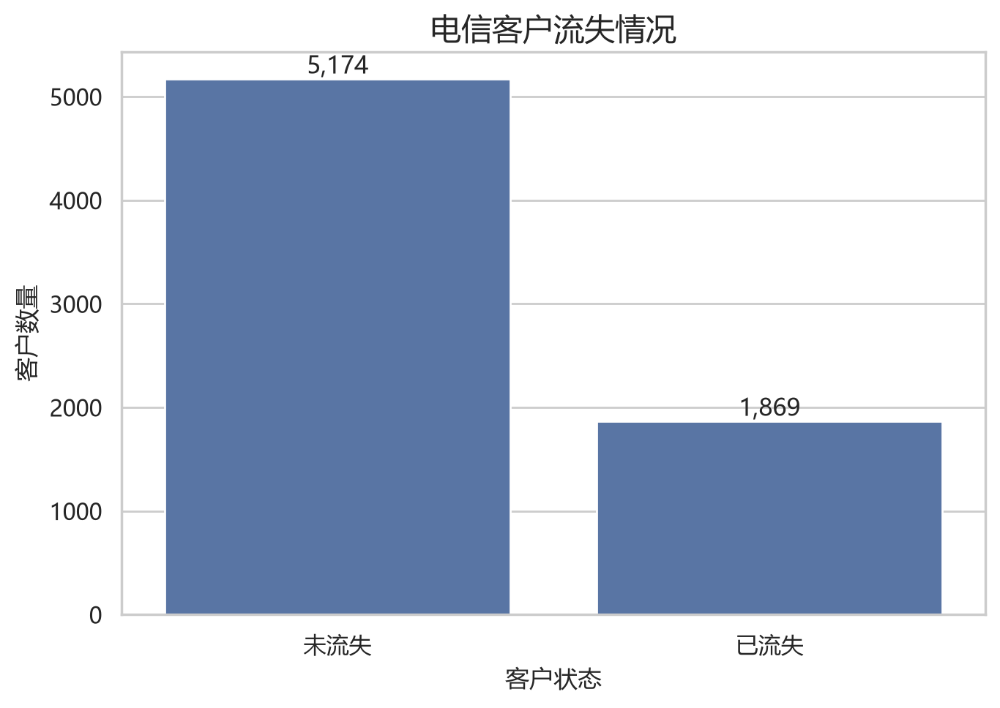
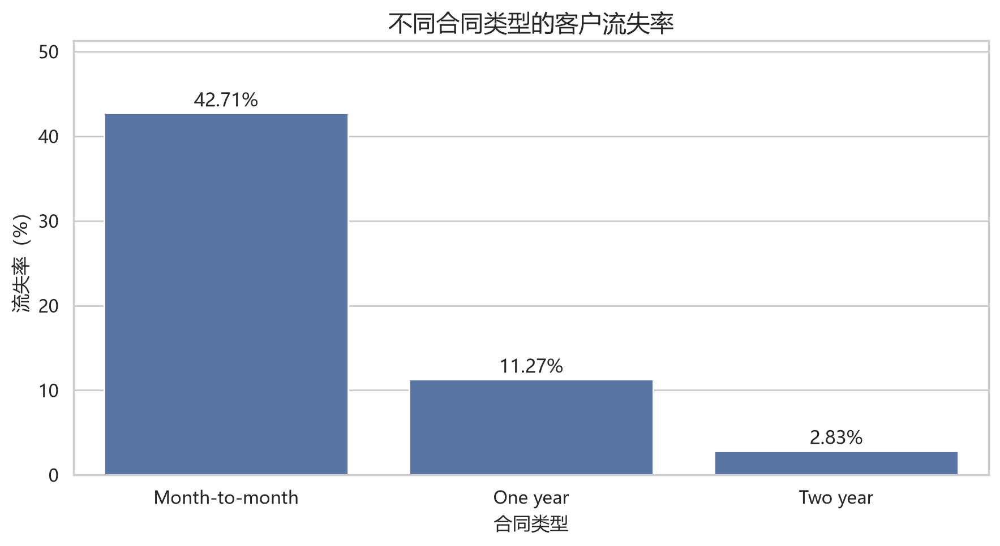
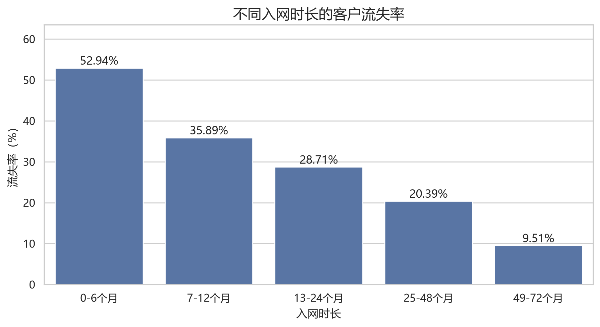
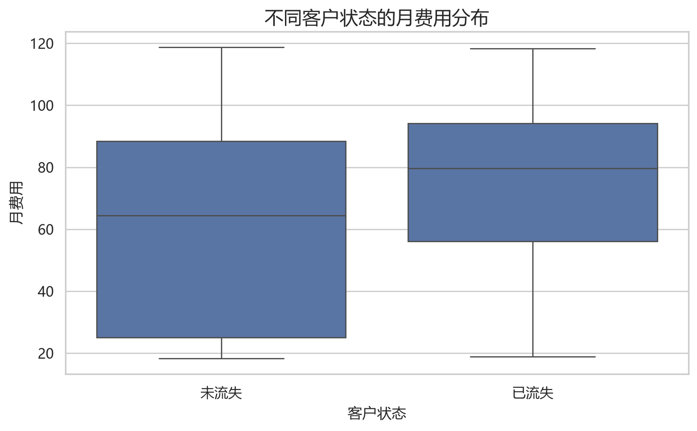
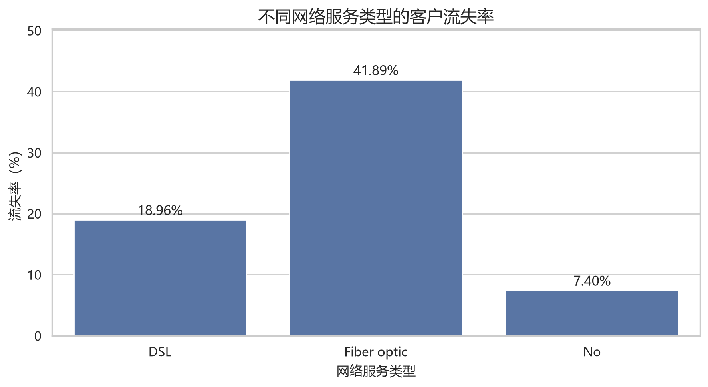
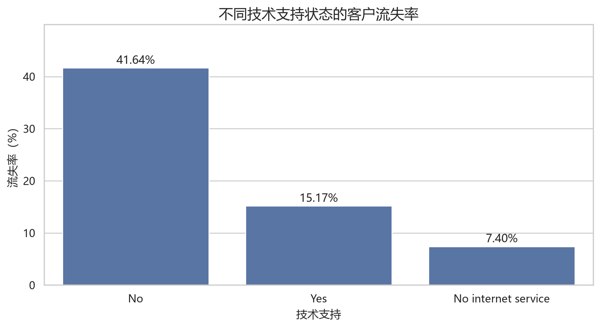
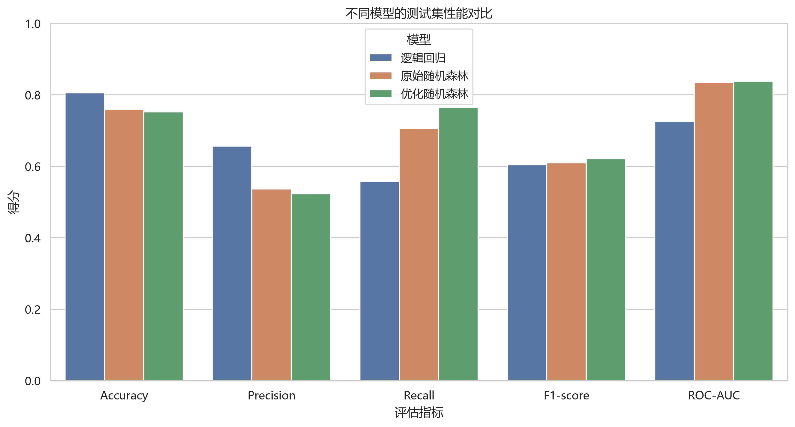
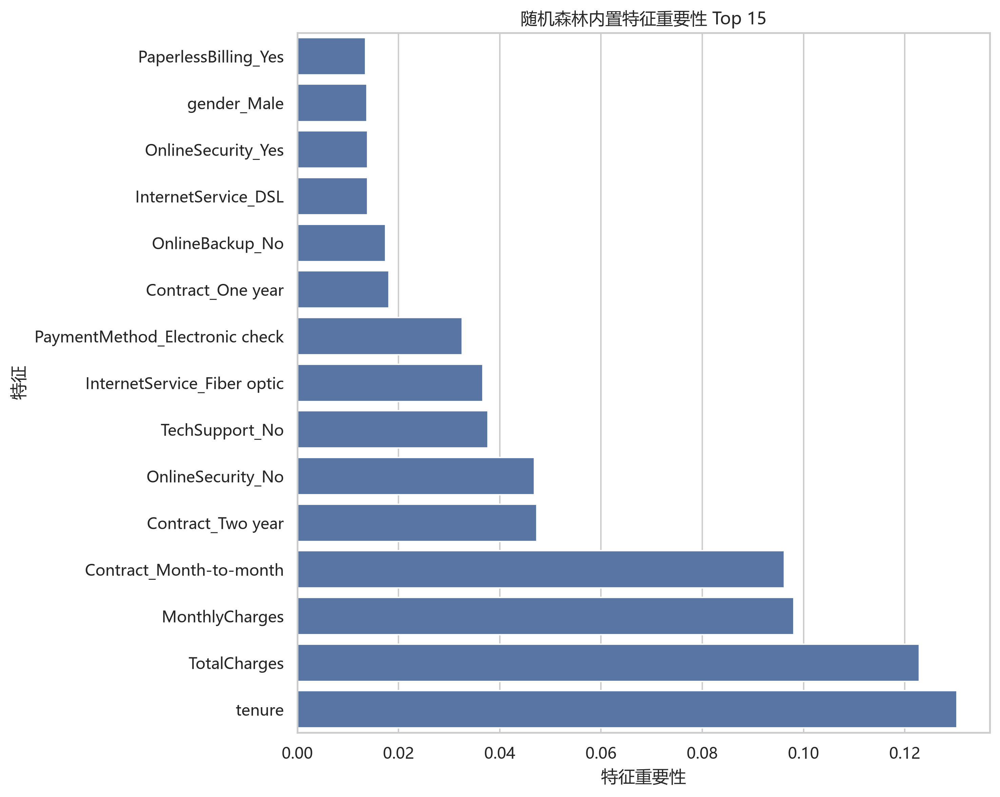
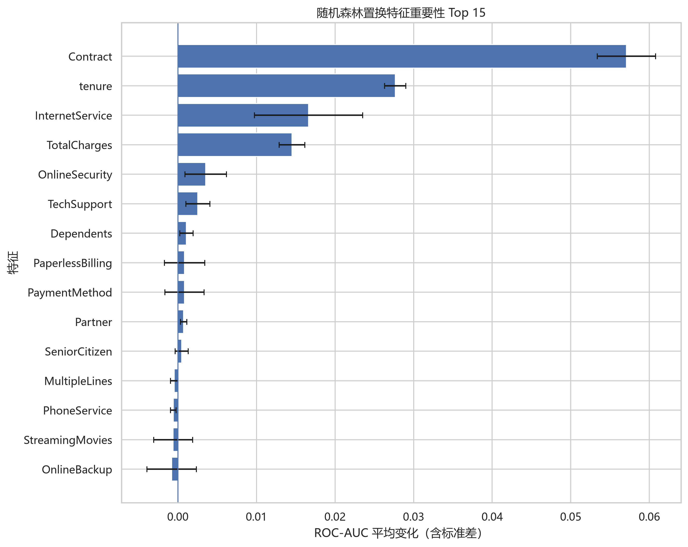

# 电信用户流失预测（Telco Customer Churn Prediction）

## 1. 项目简介

本项目基于 IBM 公开的电信客户数据集，构建机器学习模型预测客户是否可能流失，并通过探索性数据分析、模型对比、分类阈值实验和特征重要性分析，挖掘与客户流失相关的关键因素。

项目完整实践了一个典型的机器学习工作流程：

- 数据清洗与预处理
- 探索性数据分析（EDA）
- 特征工程与编码
- 逻辑回归基线模型
- 随机森林模型训练与优化
- 分类阈值分析
- 特征重要性与置换重要性分析
- 验证集选参与测试集最终评估

**项目目标：** 在识别潜在流失用户的能力与误报成本之间取得平衡，为客户留存和运营策略提供数据参考。

## 2. 技术栈

- Python
- Pandas、NumPy
- Matplotlib、Seaborn
- Scikit-learn
- 机器学习算法：逻辑回归、随机森林
- Git / GitHub

## 3. 数据集介绍

数据集：IBM Telco Customer Churn

数据来源：[IBM Telco Customer Churn Dataset](https://raw.githubusercontent.com/IBM/telco-customer-churn-on-icp4d/master/data/Telco-Customer-Churn.csv?utm_source=chatgpt.com)

数据集包含约 7,043 条客户记录、21 个字段，涵盖客户基本信息、服务订购情况、合同类型、付款方式及流失状态等信息。

目标变量：

- `Churn = Yes`：客户已流失
- `Churn = No`：客户未流失

建模前删除 `customerID`，避免将客户标识符作为预测特征。

### 3.1 数据预处理

主要处理步骤：

1. 将 `TotalCharges` 转换为数值类型。
2. 将转换过程中产生的缺失值填充为 0。
3. 删除 `customerID`。
4. 将目标变量 `Churn` 映射为二分类标签：
   - `No → 0`
   - `Yes → 1`
5. 对类别特征进行 One-Hot 编码。
6. 在数据集划分时使用分层抽样，尽可能保持训练集和测试集中的类别比例一致。

原始数据中存在 11 条 `TotalCharges` 为空白的记录。这些记录的 `tenure` 均为 0，因此在本项目中将其数值化后填充为 0。原始 CSV 文件不直接覆盖。

## 4. 探索性数据分析（EDA）

本项目通过可视化分析客户流失分布、合同类型、入网时长、月费用、网络服务类型及技术支持状态，探索与客户流失相关的特征。

所有图表由 `src/plot_eda.py` 自动生成，保存于 `reports/figures/`。

### 4.1 客户流失分布



数据集中未流失客户为 5,174 人，已流失客户为 1,869 人，流失客户约占 26.54%。因此，模型评估不能只依赖 Accuracy，还需要关注 Recall、F1 和 ROC-AUC。

### 4.2 合同类型与流失率



按月合同客户的观察流失率明显高于一年合同和两年合同客户。合同类型是后续模型预测中的重要特征。

### 4.3 入网时长与流失率



入网时长较短的客户群体具有较高的观察流失率，说明客户生命周期阶段值得在客户留存分析中重点关注。

### 4.4 月费用分布



通过箱线图比较流失和未流失客户的月费用分布。此前的统计结果显示，流失客户的平均月费用约为 74.44，未流失客户约为 61.27。该差异反映统计关联，不代表月费用直接导致流失。

### 4.5 网络服务类型与流失率



不同网络服务类型客户的观察流失率存在差异。其中，光纤网络用户的流失率相对较高，值得进一步结合合同、费用和服务体验等因素分析。

### 4.6 技术支持与流失率



未开通技术支持服务的客户群体观察流失率较高。该结果可以作为后续业务分析的线索，但仍需进一步验证服务使用情况与客户留存之间的关系。

### 4.7 EDA 结论

综合探索性分析，合同类型、入网时长、费用水平、网络服务类型和技术支持状态都值得纳入客户流失预测与业务分析。

需要注意，EDA 反映的是数据中的统计关系，不能单独证明某个特征是客户流失的原因。

## 5. 模型训练与评估

本项目使用逻辑回归建立基线模型，并进一步训练随机森林模型。随后通过验证集比较不同参数配置，选择表现较好的模型，并在独立测试集上进行最终评估。

### 5.1 模型性能对比



在默认分类阈值 0.5 下，三个模型在测试集上的表现如下：

| 评估指标 | 逻辑回归 | 原始随机森林 | 优化随机森林 |
|---|---:|---:|---:|
| Accuracy | 0.8055 | 0.7601 | 0.7523 |
| Precision | 0.6572 | 0.5366 | 0.5229 |
| Recall | 0.5588 | 0.7059 | 0.7647 |
| F1-score | 0.6040 | 0.6097 | 0.6211 |
| ROC-AUC | 0.7268 | 0.8343 | 0.8388 |

逻辑回归具有较高的准确率和精确率，但对实际流失客户的识别能力相对较弱。

优化随机森林取得了三个模型中最高的 Recall、F1-score 和 ROC-AUC。考虑到客户流失预测需要尽可能识别潜在流失客户，因此将优化随机森林作为本项目的重点模型。

需要注意，较高的 Recall 也可能伴随更多误报。实际业务中应结合客户挽留成本、营销资源及误报成本确定最终模型和分类阈值。

### 5.2 随机森林参数优化

本项目比较了不同的树深度和叶节点样本数配置，并使用验证集的 ROC-AUC 选择参数。

最终选择的参数为：

- `n_estimators=300`
- `max_depth=10`
- `min_samples_leaf=2`
- `class_weight="balanced"`
- `random_state=42`

在独立测试集上的最终结果：

- Accuracy：0.7523
- Precision：0.5229
- Recall：0.7647
- F1-score：0.6211
- ROC-AUC：0.8388

参数选择基于验证集，测试集用于最终评估，以减少根据测试集结果反复调参造成的评估偏差。

## 6. 特征重要性分析

### 6.1 随机森林内置特征重要性



根据随机森林内置特征重要性，`tenure`、`TotalCharges`、`MonthlyCharges` 以及合同类型相关特征排名靠前。

这表明客户的入网时长、费用情况和合同类型在模型的预测过程中具有较高的重要性。

需要注意，内置特征重要性可能受到特征取值类型、特征基数和树结构等因素影响，因此不能单独用它判断特征的实际业务影响。

### 6.2 置换特征重要性



置换特征重要性通过打乱单个特征的取值，观察模型 ROC-AUC 的变化，从而评估该特征对模型预测性能的贡献。

本项目中，`Contract` 的置换重要性最高，其次是 `tenure`、`InternetService` 和 `TotalCharges`。

部分特征的重要性接近零或略低于零，说明在当前模型和评估数据上，没有观察到它们带来稳定的正向预测贡献。负值不代表该特征会导致客户不流失，也可能受到随机波动和特征相关性的影响。

内置特征重要性与置换特征重要性衡量的是不同方面，因此两者的排名不完全一致是正常的。

## 7. 业务启示与局限性

结合探索性数据分析和模型结果，可以得到以下启示：

1. **关注短期客户。** 入网时长较短的客户流失率较高，可以考虑在客户入网初期提供更有针对性的服务。
2. **关注合同类型。** 月付合同客户的流失率明显高于一年期和两年期合同客户，可以进一步研究长期合同优惠和续约激励。
3. **重视服务体验。** 网络服务类型、在线安全服务及技术支持状态与客户流失存在统计关联，可用于制定进一步的客户分析方案。
4. **平衡召回率与误报成本。** 高 Recall 有助于减少漏掉的流失客户，但也可能增加挽留资源的浪费，实际应用需要结合业务成本选择阈值。

以上结论反映的是数据中的统计关联，不代表因果关系。本项目基于公开数据集进行实验，模型结果尚未经过真实业务环境验证。


## 8. 特征重要性分析

### 8.1 随机森林内置特征重要性

模型内置特征重要性排名靠前的特征包括：

| 特征 | 重要性 |
|---|---:|
| `tenure` | 0.1303 |
| `TotalCharges` | 0.1229 |
| `MonthlyCharges` | 0.0981 |
| `Contract_Month-to-month` | 0.0962 |
| `Contract_Two year` | 0.0473 |
| `OnlineSecurity_No` | 0.0468 |
| `TechSupport_No` | 0.0377 |
| `InternetService_Fiber optic` | 0.0366 |
| `PaymentMethod_Electronic check` | 0.0326 |

其中，入网时长、累计费用、月费用和合同类型具有较高的重要性。

### 8.2 置换重要性

进一步使用置换重要性，以 ROC-AUC 作为评价指标。

排名靠前的原始特征：

| 特征 | 平均重要性 |
|---|---:|
| `Contract` | 0.0571 |
| `tenure` | 0.0277 |
| `InternetService` | 0.0166 |
| `TotalCharges` | 0.0145 |
| `OnlineSecurity` | 0.0035 |
| `TechSupport` | 0.0025 |

置换重要性结果表明，合同类型、入网时长、网络类型和累计费用对当前模型的预测能力具有较明显的贡献。

两种重要性方法的排名存在差异，是因为它们衡量的内容不同。此外，相关特征可能包含重叠信息，因此特征重要性不能简单地解释为独立影响或因果效应。

## 9. 业务建议

根据探索性分析和模型结果，可以提出以下待验证的业务建议：

1. **关注新入网客户。** 新入网客户群体的观察流失率较高，可考虑设计新客引导、使用教育及早期关怀方案。
2. **关注按月合同客户。** 该群体流失率较高，可进一步研究长期合同优惠、服务体验和合同转换意愿。
3. **评估服务支持方案。** 对缺少在线安全服务或技术支持的客户开展进一步分析，验证相关服务是否与客户满意度及留存有关。
4. **建立风险分层机制。** 根据模型输出的流失概率将客户分层，辅助运营人员安排回访和挽留资源。
5. **评估挽留活动的实际效果。** 通过对照实验检验优惠券、服务升级或客户关怀是否真正降低流失，而不是仅凭模型相关性决定策略。

模型预测的是流失风险，不代表客户一定会流失，也不代表采取某种挽留措施一定有效。

## 10. 项目结构

```text
telco-churn-prediction/
├── data/
│   └── Telco-Customer-Churn.csv
├── notebooks/
├── src/
│   ├── check_data.py
│   ├── train_baseline.py
│   ├── train_random_forest.py
│   └── tune_random_forest.py
├── models/
├── requirements.txt
└── README.md
```

## 11. 环境配置与运行

### 11.1 创建虚拟环境

```bash
python -m venv .venv
```

Windows PowerShell 激活环境：

```powershell
.\.venv\Scripts\Activate.ps1
```

### 11.2 安装依赖

```bash
pip install -r requirements.txt
```

如果尚未生成 `requirements.txt`，可以安装以下依赖：

```bash
pip install pandas numpy matplotlib seaborn scikit-learn jupyter
```

### 11.3 运行模型

在项目根目录运行：

```bash
python src/check_data.py
python src/train_baseline.py
python src/train_random_forest.py
python src/tune_random_forest.py
```

运行前请确认数据文件位于 `data/Telco-Customer-Churn.csv`。

## 12. 项目总结与局限性

本项目完成了从数据清洗、探索性分析、基线模型构建到随机森林优化和特征重要性分析的完整机器学习实践。

最终，优化随机森林在测试集上取得 ROC-AUC 0.8388、Recall 76.47% 和 F1-score 62.11% 的结果，体现出一定的客户流失识别能力。

当前项目仍存在一些局限：

- 模型评估依赖单次数据集划分，结果可能受随机划分影响。
- 目前主要比较了逻辑回归和随机森林，尚未系统评估梯度提升树等其他模型。
- 分类阈值仍需结合业务成本在验证集上选择。
- 特征重要性反映模型预测中的关联，不能直接推断因果关系。
- 还没有通过真实业务实验验证客户挽留策略的有效性。

后续可以继续尝试交叉验证、梯度提升树、SHAP 模型解释、概率校准及基于业务成本的阈值优化。

---

**关键词：** 机器学习、客户流失预测、逻辑回归、随机森林、特征工程、模型评估、分类阈值、特征重要性
